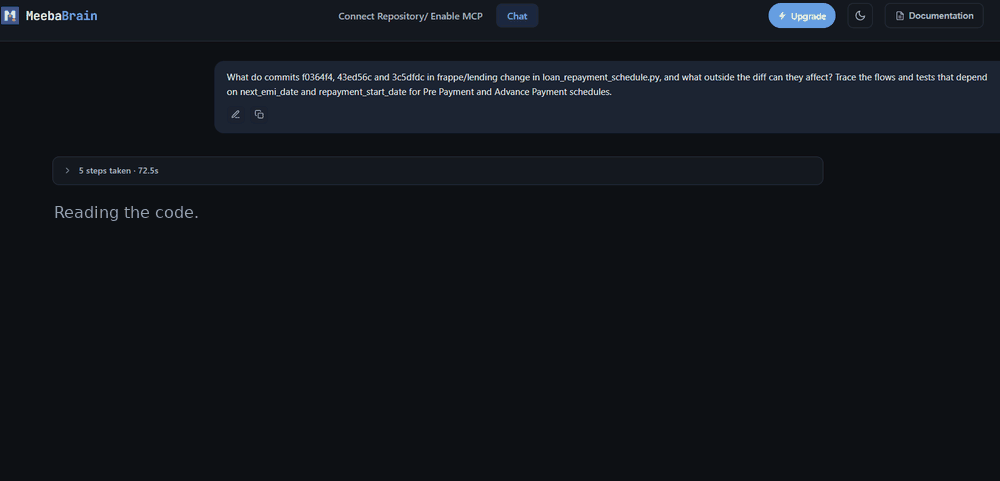

# Meeba Brain

**Know what your code change really breaks, with evidence.**

*Built from screenshots of a real answer on frappe/lending (72.5 s run). See the [case study](demos/frappe-lending-1537-early-payment-first-emi.md).*

Meeba Brain is an evidence-first code intelligence layer for teams using AI coding tools. It traces impact and root causes across large codebases, cites the exact code behind every claim, and marks what it couldn't verify. It works in the web app and inside Cursor and Claude Code via MCP.

This repository holds public, checkable examples of Meeba Brain on real open-source code: the question, the answer, the exact lines behind it, and where the answer fell short.

- Try it: [meeba.ai/brain](https://meeba.ai/brain) (free to start, read-only GitHub access)
- Discuss a case or send a counterexample: [Discussions](https://github.com/meemoprasad/meeba-brain/discussions)

> "Meeba Brain is a useful debugging tool, and it handles large open-source repos well."
>
> — [Aakash Bhardwaj](https://www.linkedin.com/in/aakash-bhardwaj-sky/), Solution Architect, Senior AI Engineer

> "An answer where every claim links to the exact line is much easier to trust than a confident summary."
>
> — [Milind Bansal](https://github.com/MilindDevX), open-source contributor (author of Composio PR #5024)

## Case studies

<!-- cases:start -->
| Case | Question | What to check |
|---|---|---|
| [frappe/lending: early payment and the first EMI date](demos/frappe-lending-1537-early-payment-first-emi.md) | What do the three commits in the merged fix [#1537](https://github.com/frappe/lending/pull/1537) change, and what outside the diff can they affect? | Outside the diff: the effect on interest for the deferred period (which the answer missed) and a test gap for interest-only first EMIs; then the call chain and line references |
| [Composio Python SDK: unresolved annotation error](demos/composio-5022-annotation-resolution.md) | What does the proposed fix for issue [#5022](https://github.com/ComposioHQ/composio/issues/5022) ([PR #5024](https://github.com/ComposioHQ/composio/pull/5024)) really change? (The issue was later fixed by the maintainers in [#5061](https://github.com/ComposioHQ/composio/pull/5061).) | Outside the diff: one caller of the changed private function; then the behaviour changes, the tests that cover them, and one test the answer named wrongly |
<!-- cases:end -->

Each case study is an independent analysis. It is not an endorsement by the project's maintainers, and it says whether the change was merged.

## Where Meeba Brain fits

| If your team uses | They're good at | Meeba Brain adds |
|---|---|---|
| AI coding agents (Cursor, Claude Code, Copilot, Codex) | Writing and editing code | Evidence for every claim, in the same editor through MCP |
| AI code review (CodeRabbit, Greptile, Qodo) | Comments on the pull request | What the change affects outside its diff |
| Code search (Sourcegraph, DeepWiki) | Finding where code lives | Whether a claim about that code is true, with the lines that show it |
| Production RCA (Sentry Seer, observability AI) | Finding the incident in logs and traces | The code path behind the error, and what else a fix will touch |

## How to judge an answer

Use this on our case studies, and on any AI answer about code:

1. Are the cited files and lines real, and do they say what the answer claims?
2. Is a claim marked verified only when the code or a run shows it?
3. Does the answer say what it did not check?
4. Can the behaviour be reproduced, and is the fix covered by a test?

## What to expect today

- On a large repository an answer usually takes 1 to 2 minutes, because it reads the code before answering.
- It can still be wrong. That's why every claim links to the exact lines, so you can check it in one click.
- It asks for read-only GitHub access. We don't have SOC 2 yet, so many teams start on a public or non-sensitive repository.

## Contributing a case

Open a discussion with: the repository and commit, the question you asked, the answer, the lines you checked, and what was right or wrong. Counterexamples are as welcome as good results. Please don't post credentials, private code, personal data or production logs.

---

Built by [Meeba AI](https://meeba.ai) (Inteligrator Technologies Pvt. Ltd., Raipur, India).
