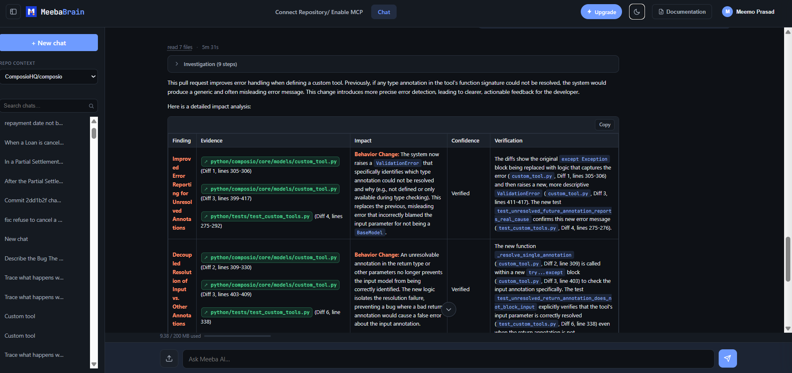
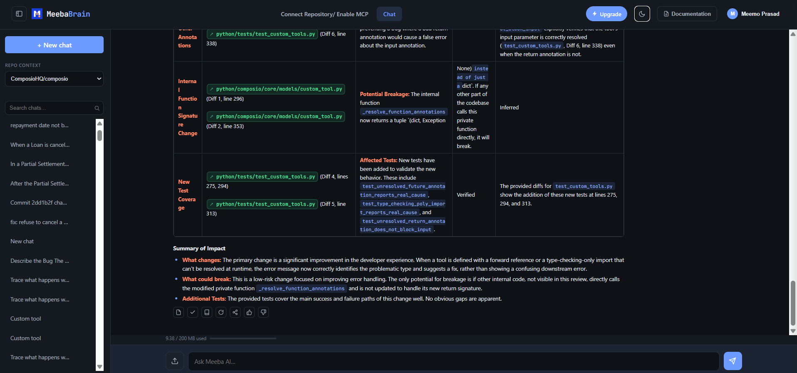

# Case Study: Evidence-Linked Analysis of a Python SDK Bug

## Overview

**Project:** [Composio](https://github.com/ComposioHQ/composio)  
**Issue:** [#5022 — Misleading error for unresolved input annotations](https://github.com/ComposioHQ/composio/issues/5022)  
**Proposed fix:** [PR #5024](https://github.com/ComposioHQ/composio/pull/5024)  
**Status:** PR open and unmerged at the time of this case study's review.

This case examines whether Meeba Brain can explain a real code change, connect findings to implementation and test evidence, and distinguish verified behavior from potential risks.

## The engineering problem

A custom tool defined with postponed Python annotations can fail when its input model is declared after the tool or imported only under `TYPE_CHECKING`.

The original error could incorrectly suggest that the input parameter was not annotated with a Pydantic `BaseModel`, even when the underlying problem was that the annotation could not be resolved at runtime.

See the original [issue and minimal reproduction](https://github.com/ComposioHQ/composio/issues/5022).

## What the proposed PR changes

The proposed change in [PR #5024](https://github.com/ComposioHQ/composio/pull/5024/files) focuses on three behaviors:

1. **Preserve annotation-resolution errors.** `_resolve_function_annotations` returns the resolution error along with any resolved annotations instead of silently discarding the exception.
2. **Resolve the input annotation independently.** When resolving the entire function signature fails, the code attempts to resolve the input annotation separately. This avoids blaming a valid input annotation for an unrelated unresolved return annotation.
3. **Provide actionable validation errors.** When the input annotation itself cannot be resolved, the error identifies the annotation and the underlying exception, with guidance on how to fix the definition or import.

## Regression tests

The PR adds tests for:

- An input model defined after the decorated function.
- An input model imported only under `TYPE_CHECKING`.
- A valid input model paired with an unresolved return annotation.

These tests target the changed behavior. Their existence does not, by itself, establish that every relevant edge case is covered.

See the [PR diff and test changes](https://github.com/ComposioHQ/composio/pull/5024/files).

## Meeba Brain analysis

The initial Meeba Brain response identified the main behavior changes, connected them to the tests, and separated a potential internal compatibility concern from verified findings.

The review also revealed improvements needed in the analysis itself:

- Test names should be checked against the actual source.
- Evidence should link directly to the relevant code rather than relying only on diff-relative line numbers.
- Claims that test coverage is complete should be qualified unless broader testing supports them.
- Potential breakage from changing a private function's return contract should be investigated by checking its callers, rather than assumed to be the only possible risk.

This is an important part of evaluating evidence-grounded tools: the analysis must itself be independently verifiable.

<!-- Paste this into demos/composio-5022-annotation-resolution.md, right after the
     summary at the top (before the screenshots). Every link is pinned to a commit,
     so the line numbers stay correct even after the branches move.
     Base = next @ 6f94cc9 (the commit the issue reproduced on).
     Fix  = PR #5024 head @ 7781213. -->

## Evidence

**The bug, on `next` at [`6f94cc9`](https://github.com/ComposioHQ/composio/commit/6f94cc9068708bb84e060164d8d99879ae8288f9)**

| What | Where |
|---|---|
| `_resolve_function_annotations` catches every exception from `typing.get_type_hints` and returns `{}`, so the real `NameError` is lost | [`custom_tool.py:298-306`](https://github.com/ComposioHQ/composio/blob/6f94cc9068708bb84e060164d8d99879ae8288f9/python/composio/core/models/custom_tool.py#L298-L306) |
| The first parameter falls back to the raw string annotation `'SearchInput'` | [`custom_tool.py:374`](https://github.com/ComposioHQ/composio/blob/6f94cc9068708bb84e060164d8d99879ae8288f9/python/composio/core/models/custom_tool.py#L374) |
| A string is not a `BaseModel` subclass, so the user sees "must be annotated with a Pydantic BaseModel subclass" | [`custom_tool.py:375-382`](https://github.com/ComposioHQ/composio/blob/6f94cc9068708bb84e060164d8d99879ae8288f9/python/composio/core/models/custom_tool.py#L375-L382) |
| The existing test only covers a model defined above the tool | [`test_custom_tools.py`, `test_future_annotations_are_resolved`](https://github.com/ComposioHQ/composio/blob/7781213ffa1804665942f514311afaff9999fac2/python/tests/test_custom_tools.py#L340) |

**The proposed fix, PR #5024 at [`7781213`](https://github.com/ComposioHQ/composio/commit/7781213ffa1804665942f514311afaff9999fac2)**

| Change | Where |
|---|---|
| `_resolve_function_annotations` now returns the error with the annotations, instead of dropping it | [`custom_tool.py:292-306`](https://github.com/ComposioHQ/composio/blob/7781213ffa1804665942f514311afaff9999fac2/python/composio/core/models/custom_tool.py#L292-L306) |
| New `_resolve_single_annotation` resolves only the input annotation, so an unresolved return type doesn't blame a valid input | [`custom_tool.py:309-330`](https://github.com/ComposioHQ/composio/blob/7781213ffa1804665942f514311afaff9999fac2/python/composio/core/models/custom_tool.py#L309-L330) |
| If the input annotation still can't be resolved, the error names it and the underlying exception, with how to fix it | [`custom_tool.py:399-417`](https://github.com/ComposioHQ/composio/blob/7781213ffa1804665942f514311afaff9999fac2/python/composio/core/models/custom_tool.py#L399-L417) |
| The only caller of the changed private function, updated for the new return value | [`custom_tool.py:377`](https://github.com/ComposioHQ/composio/blob/7781213ffa1804665942f514311afaff9999fac2/python/composio/core/models/custom_tool.py#L377) |

**New regression tests in the PR**

| Test | Case |
|---|---|
| [`test_unresolved_future_annotation_reports_real_cause`](https://github.com/ComposioHQ/composio/blob/7781213ffa1804665942f514311afaff9999fac2/python/tests/test_custom_tools.py#L275) | Input model defined after the tool |
| [`test_type_checking_only_import_reports_real_cause`](https://github.com/ComposioHQ/composio/blob/7781213ffa1804665942f514311afaff9999fac2/python/tests/test_custom_tools.py#L294) | Input model imported only under `TYPE_CHECKING` |
| [`test_unresolved_return_annotation_does_not_block_input`](https://github.com/ComposioHQ/composio/blob/7781213ffa1804665942f514311afaff9999fac2/python/tests/test_custom_tools.py#L313) | Valid input with an unresolvable return annotation |

**How Meeba Brain's answer held up**

| Claim in the answer | Status |
|---|---|
| The resolution error is now kept instead of swallowed | Verified, lines 292-306 above |
| The input annotation is resolved on its own before it is blamed | Verified, lines 309-330 and 399-417 |
| The change is covered by new regression tests | Verified, but one test was named wrongly in the answer. The real names are in the table above |
| Changing the private function's return value could break other callers | Flagged as a risk, not checked by the answer. Checked by hand: there is one caller, line 377, and the PR updates it |
| Line references | The answer cited diff-relative line numbers. The table above replaces them with links pinned to commits |
| How much the tests cover | Needed qualifying: the three tests cover the three reported cases, not every way an annotation can fail to resolve |

The analysis is independent and not an endorsement by Composio. The issue was reported by the author of this case study; the fix was written by another contributor ([@MilindDevX](https://github.com/MilindDevX)). At the time of writing PR #5024 is open, not merged.

## Actual Meeba Brain output

The following screenshots show the product analyzing
the Composio pull request in its repository context.

**Investigation:** 7 files read in 5 minutes 31 seconds.

### Findings and source evidence

### Risk analysis and test coverage

## Evaluation checklist

Use this case to assess whether an analysis:

- Correctly explains the original failure.
- Describes the proposed implementation change accurately.
- Links claims to relevant source lines and tests.
- Identifies unsupported assumptions and potential regressions.
- Distinguishes the existence of tests from proof of complete coverage.

## Conclusion

A useful code-impact review should do more than summarize a diff. It should help an engineer understand what changed, why it matters, what evidence supports the conclusions, and what still needs verification.

Meeba Brain is being developed around that evidence-first approach.

**Product:** [Meeba Brain](https://meeba.ai/brain)
